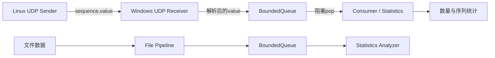

# TelemetryLab：跨平台 UDP 遥测与发送调度实验

TelemetryLab 是一个基于 C++17 的跨平台网络实验项目。学校 Linux 服务器按照指定速率发送带序列号的 UDP 遥测数据，Windows 接收端使用生产者—消费者流水线处理报文，并统计缺失、重复、乱序和发送调度抖动。

项目重点不是证明 UDP 是否“可靠”，而是练习完整的工程过程：跨平台 Socket 编程、并发队列、可控速率发送、实验设计，以及根据证据限定结论。

## 项目结果

- 完成 Windows Winsock 与 Linux POSIX Socket 的跨设备 UDP 通信；
- 实现有界阻塞队列、背压和正常关闭；
- 实现序列号缺失、重复、乱序和遥测数值统计；
- 实现 `catchup` 与 `reset` 两种发送调度策略；
- 在校园网络中完成 3 组、共 6 轮 `10000 packets/s` 配对实验；
- 观察到追赶式调度可能产生微突发，但没有证据表明它是报文缺失的主要原因。

在实验中，`catchup` 曾出现 `3876.582 us` 最大迟到、45 次连续追赶和 66 个小于 `25 us` 的发送间隔；但 `reset` 的汇总缺失率并没有更低。因此，本项目保留“微突发存在”和“缺失根因尚未定位”这两个彼此独立的结论。

完整实验过程见[`docs/udp_experiment_report.md`](docs/udp_experiment_report.md)，结构化结果见[`results/scheduling_comparison.csv`](results/scheduling_comparison.csv)。

## 系统结构



接收线程只负责尽快读取和解析数据；消费者线程负责统计。队列满时生产者等待，队列空时消费者等待，接收结束后通过`close()`唤醒消费者并自然退出。

## 核心实现

### 有界阻塞队列

`BoundedQueue`使用`std::mutex`和两个`std::condition_variable`实现：

- 队列满时，`push()`等待可用空间；
- 队列空时，`pop()`等待新数据；
- `close()`后不再接收新数据，并唤醒等待线程；
- 禁止复制，避免多份对象错误地共享同步状态；
- 不使用`detach`或基于`sleep`的线程同步。

### UDP报文

每个数据报是一个独立文本消息：

```text
sequence,value
```

例如：

```text
1,10.25
2,10.40
3,9.95
```

序列号用于识别接收端观察到的缺失、重复和乱序；`value`用于计算`min/max/mean/p50/p95/p99`。这些分位数描述遥测数值，不是网络时延。

## 构建

要求：CMake 3.16或更高版本、支持C++17的编译器，以及Linux pthread或Windows Winsock 2。

### Windows

在Developer PowerShell for Visual Studio中执行：

```powershell
cd C:\Users\16862\cpp_learning\telemetry_lab
cmake -S . -B build-windows
cmake --build build-windows --config Debug
```

生成：

```text
build-windows\Debug\telemetry_analyze.exe
build-windows\Debug\telemetry_udp_sender.exe
build-windows\Debug\telemetry_udp_receiver.exe
```

### Linux

```bash
cd ~/telemetry_lab
cmake -S . -B build-linux -DCMAKE_BUILD_TYPE=Debug
cmake --build build-linux -j
```

生成：

```text
build-linux/telemetry_analyze
build-linux/telemetry_udp_sender
build-linux/telemetry_udp_receiver
```

## 快速运行：Linux发送，Windows接收

### 1. Windows启动接收端

下面的`15000`表示接收15秒，端口固定为UDP 9000：

```powershell
.\build-windows\Debug\telemetry_udp_receiver.exe 15000
```

如果省略持续时间，接收端持续运行，按`Ctrl+C`结束。

### 2. Linux启动发送端

```bash
./build-linux/telemetry_udp_sender \
  10.29.213.237 9000 10000 10000 catchup
```

参数依次为：

```text
<Windows IPv4> <UDP端口> <packets/s> <持续时间ms> [catchup|reset]
```

其中`10.29.213.237`只是实验时使用过的示例地址。运行前应在Windows执行`ipconfig`，替换成学校服务器能够访问的实际IPv4地址。不要把尖括号写进命令。

应先启动接收端，再启动发送端。接收端的运行时间应略长于发送端，以免接收窗口提前结束。

### Windows防火墙

如果收不到报文，可在管理员PowerShell中允许可信网络的UDP 9000入站：

```powershell
New-NetFirewallRule -DisplayName "TelemetryLab UDP 9000" -Direction Inbound -Protocol UDP -LocalPort 9000 -Action Allow
```

同时确认Linux能够访问Windows地址。`127.0.0.1`只代表运行程序的当前机器，不能用于Linux向Windows跨设备发送。

## 本机回环验证

跨设备实验前，可先在同一台机器上运行接收端和发送端，验证程序退出、序列统计和计数关系。

Windows发送端只用于本机回环，参数为发送速率和持续时间：

```powershell
.\build-windows\Debug\telemetry_udp_receiver.exe 12000
.\build-windows\Debug\telemetry_udp_sender.exe 10000 10000
```

Linux也可以分别启动本机接收端和以`127.0.0.1`为目标的发送端：

```bash
./build-linux/telemetry_udp_receiver 12000
./build-linux/telemetry_udp_sender 127.0.0.1 9000 10000 10000 catchup
```

## 文件并发流水线

项目保留了一个不依赖网络的并发流水线，用于验证`BoundedQueue`、关闭协议和统计模块：

```bash
./build-linux/telemetry_analyze data/sample.txt 64
```

参数为输入文件和队列容量。程序输出有效行、无效行以及遥测数值的统计结果。

## 两种发送调度策略

### catchup

维持最初的绝对时间表。如果线程醒来时已经落后，后续发送可能连续追赶，从而产生很短的相邻发送间隔。

### reset

当发送线程至少落后一个目标间隔时，以当前时间重新安排下一次发送，不连续追赶旧时间表。

在相同的`10000 packets/s、10秒`条件下，可以分别运行：

```bash
./build-linux/telemetry_udp_sender 10.29.213.237 9000 10000 10000 catchup
./build-linux/telemetry_udp_sender 10.29.213.237 9000 10000 10000 reset
```

每一轮都应重新启动Windows接收端，并记录发送端与接收端的完整输出。

## 正式实验结果

| 策略 | 3轮总发送 | 3轮总接收 | 总缺失 | 汇总缺失率 |
|---|---:|---:|---:|---:|
| catchup | 300000 | 299956 | 44 | 0.01467% |
| reset | 299970 | 299917 | 53 | 0.01767% |

实验支持的结论：

1. `catchup`在调度迟到后可能产生连续追赶和微突发；
2. `reset`能够消除连续追赶；
3. `reset`没有稳定降低报文缺失率；
4. 现有数据不能证明微突发是UDP缺失的主要原因；
5. 不同轮次的缺失存在明显波动，最终根因仍未定位。

## 指标解释

| 指标 | 含义 | 不能说明什么 |
|---|---|---|
| Sent packets | 应用成功交给本机UDP协议栈的数据报数 | 不等于对端实际收到的数量 |
| Missing | 已观察序列号范围内的空洞 | 无法发现最大序列号之后的尾部缺失 |
| Duplicate | 重复收到的序列号数量 | 不代表发送端重复发送的唯一原因 |
| Out-of-order | 到达顺序落后于此前最高序列号的事件 | 单独不能定位乱序发生位置 |
| Schedule misses | 发送线程至少落后一个计划间隔的次数 | 不等同于网络丢包 |
| Maximum lateness | 用户态发送调度的最大迟到 | 不能单独证明网络拥塞 |
| Catch-up streak | 连续追赶已到期发送计划的最大次数 | 不能单独建立与丢包的因果关系 |
| p50/p95/p99 | 遥测`value`的分布 | 不是RTT或端到端时延 |

## 项目结构

```text
telemetry_lab/
├── apps/
│   ├── file_analyzer.cpp          文件并发流水线入口
│   ├── udp_sender.cpp             Windows回环发送端
│   ├── udp_receiver.cpp           Windows接收端
│   ├── udp_sender_linux.cpp       Linux可配置发送端
│   └── udp_receiver_linux.cpp     Linux接收端
├── include/telemetry/
│   ├── bounded_queue.hpp
│   ├── file_pipeline.hpp
│   └── statistics.hpp
├── src/                            核心实现
├── data/sample.txt                 示例遥测数据
├── docs/udp_experiment_report.md   完整实验报告
├── results/scheduling_comparison.csv
└── CMakeLists.txt
```

## 实验边界

- 尚未进行Linux和Windows双端同步抓包；
- 尚未控制Windows `SO_RCVBUF`进行对照实验；
- 没有实现双端时钟同步和端到端单向时延测量；
- 本机回环与跨设备实验的操作系统和网络路径不同，不能仅凭两者差异归因；
- 项目已经完成当前学习目标，不再通过增加轮数无限追查网络缺失。

TelemetryLab最终形成了一个可运行的C++并发网络原型和一组真实实验记录。它是后续TCP上位机、ROS 2通信与机器人弱网控制项目的基础。
