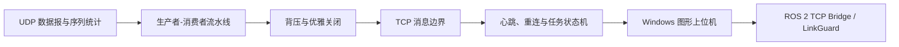
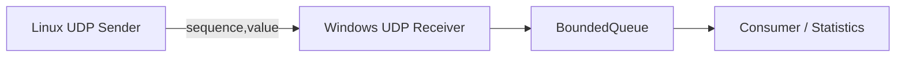
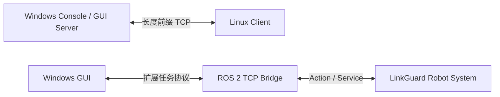

# C++ Networking Labs

一组面向跨平台网络通信与机器人上位机开发的 C++17 工程实践。项目从 UDP 遥测与并发流水线出发，逐步扩展到 TCP 消息边界、心跳重连、任务状态机和 Windows 图形上位机，并最终接入 [LinkGuard ROS 2 机器人通信系统](https://github.com/lzyyuna/ros2_linkguard_project)。

本仓库关注的不只是“把 Socket 跑通”，还包括并发关闭协议、弱网实验、故障恢复、跨平台构建，以及如何根据实验数据限定工程结论。

## 项目概览

| 项目 | 解决的问题 | 核心实现 | 当前成果 |
|---|---|---|---|
| [TelemetryLab](telemetry_lab/) | 如何接收高频 UDP 遥测，并将网络接收与数据处理解耦 | POSIX Socket / Winsock、`BoundedQueue`、条件变量、背压、可控速率发送 | 完成 Linux→Windows 跨设备通信及 6 轮、每秒 10000 包的调度对照实验 |
| [TCP Stream Lab](tcp_stream_lab/) | 如何在 TCP 字节流上实现可靠消息边界，并处理任务、断线和重连 | 长度前缀帧、`send_all` / `receive_exact`、心跳、重连、状态机、Win32/GDI | 完成独立 TCP 协议实验，并实现可连接 ROS 2 LinkGuard 的 Windows 图形上位机 |

## 学习与工程递进



两个项目不是互不相关的示例：TelemetryLab 解决数据通路和并发处理问题，TCP Stream Lab 进一步处理长连接、控制语义和故障恢复；随后由 TCP/ROS 2 桥接节点把 Windows 上位机接入机器人任务系统。

## 1. TelemetryLab：UDP 遥测与发送调度



主要实现：

- Linux POSIX Socket 与 Windows Winsock 跨设备 UDP 通信；
- 基于 `mutex` 和 `condition_variable` 的有界阻塞队列；
- 队列背压、`close()` 唤醒和线程自然退出；
- 缺失、重复、乱序及遥测数值统计；
- `catchup` 与 `reset` 两种定时发送策略；
- 发送迟到、连续追赶和相邻发送间隔统计。

实验在校园网络中以 `10000 packets/s` 完成 3 组配对、共 6 轮测试。结果观察到追赶式调度可能产生微突发，但 `reset` 策略没有稳定降低缺失率，因此没有把相关性表述成因果关系。

详细设计、运行命令和实验边界见 [TelemetryLab README](telemetry_lab/README.md)。

## 2. TCP Stream Lab：任务协议与图形上位机



主要实现：

- 使用“4 字节网络字节序长度 + UTF-8 正文”处理 TCP 粘包和拆包；
- 使用 `send_all()` 和 `receive_exact()` 完成完整帧收发；
- Linux 主动连接 Windows，适应学校服务器不便被外部直接访问的环境；
- `HELLO/WELCOME` 握手、`PING/PONG` 心跳和断线重连；
- `START/STATUS/STOP/RESULT` 任务协议与运行状态机；
- 避免断线后自动重放未确认任务，降低重复执行风险；
- Win32/GDI 图形上位机显示机器人位置、目标、轨迹、任务进度和网络状态；
- 通过桥接节点控制 ROS 2 Action，并切换正常、拥塞和中断网络档位。

详细协议、构建方式和两种运行模式见 [TCP Stream Lab README](tcp_stream_lab/README.md)。

## 与 LinkGuard 的关系

三个部分组成一条完整的学习与演示链路：

```text
C++ Networking Labs
├── TelemetryLab       并发数据通路、UDP实验和证据分析
└── TCP Stream Lab     长连接、任务协议和Windows上位机
                              │
                              ▼
LinkGuard ROS 2 Project       Action任务、网络仿真、弱网控制和机器人状态
```

Windows 不需要安装 ROS 2。图形上位机通过 TCP 与 Linux 上的 `linkguard_tcp_bridge` 通信；桥接节点再把上位机命令转换为 ROS 2 Action 和 Service 调用。

## 技术栈

- C++17、RAII、STL、线程与条件变量；
- UDP、TCP、POSIX Socket、Winsock 2；
- CMake 跨平台构建；
- Win32 API / GDI 图形界面；
- Linux / Windows 跨设备部署；
- ROS 2 Action、Service 与自定义接口桥接。

## 快速开始

两个子项目可以独立构建。要求 CMake 3.16 或更高版本，以及支持 C++17 的编译器。

### Windows

```powershell
cmake -S telemetry_lab -B telemetry_lab/build-windows
cmake --build telemetry_lab/build-windows --config Debug

cmake -S tcp_stream_lab -B tcp_stream_lab/build/windows -A x64
cmake --build tcp_stream_lab/build/windows --config Debug
```

### Linux

```bash
cmake -S telemetry_lab -B telemetry_lab/build-linux -DCMAKE_BUILD_TYPE=Debug
cmake --build telemetry_lab/build-linux -j

cmake -S tcp_stream_lab -B tcp_stream_lab/build/linux -DCMAKE_BUILD_TYPE=Debug
cmake --build tcp_stream_lab/build/linux -j
```

具体程序参数、防火墙设置和跨设备运行顺序请查看对应子项目 README。

## 仓库结构

```text
cpp-networking-labs/
├── telemetry_lab/
│   ├── apps/                 UDP发送端、接收端和文件分析入口
│   ├── include/telemetry/    队列、统计和流水线接口
│   ├── src/                  核心实现
│   ├── docs/                 UDP实验报告
│   └── results/              结构化实验结果
├── tcp_stream_lab/
│   ├── apps/
│   │   ├── tcp_server_win.cpp
│   │   ├── tcp_server_gui_win.cpp
│   │   └── tcp_client_linux.cpp
│   └── CMakeLists.txt
└── README.md
```

## 工程边界

- 项目定位为学习和作品集工程，不是面向公网部署的生产控制系统；
- TCP 协议当前没有 TLS、身份认证和持久化消息队列；
- UDP 实验没有完成双端同步抓包，因此没有对缺失根因作过度归因；
- 图形上位机强调通信链路和状态展示，不追求复杂 UI 框架；
- ROS 2 机器人仿真与弱网控制逻辑位于独立的 LinkGuard 仓库。

## 延伸项目

- [LinkGuard ROS 2 Project](https://github.com/lzyyuna/ros2_linkguard_project)：网络感知型机器人任务系统，包含 ROS 2 Action/Service、链路仿真、通信状态机、QoS 对照实验和 TCP 桥接。
