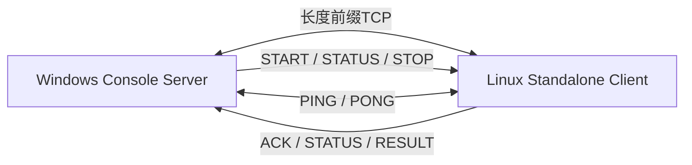
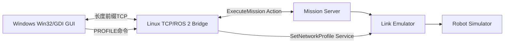

# TCP Stream Lab：跨平台机器人上位机通信

TCP Stream Lab 是一个基于 C++17 的跨 Windows/Linux 通信项目。Windows负责监听连接和下发任务，Linux主动连接Windows并返回任务状态。项目同时提供控制台协议实验和图形化LinkGuard上位机两种运行模式。

这个仓库主要解决三个问题：

1. 如何在TCP字节流上定义可靠的消息边界；
2. 如何处理心跳、断线、重连和任务状态；
3. 如何让Windows上位机在不安装ROS 2的情况下控制Linux上的ROS 2机器人。

## 两种运行模式

| 模式 | Windows程序 | Linux程序 | 端口 | 用途 |
|---|---|---|---:|---|
| 独立TCP实验 | `tcp_server_win` | `tcp_client_linux` | 默认9001 | 验证帧协议、心跳、重连和任务状态机 |
| LinkGuard演示 | `tcp_server_gui_win` | ROS 2 `linkguard_tcp_bridge` | 固定19001 | 图形化控制机器人、显示轨迹并切换网络档位 |

这两种模式不要混用：图形上位机使用扩展的机器人任务协议，应连接LinkGuard桥接节点；仓库中的`tcp_client_linux`是早期的独立任务模拟器，不负责ROS 2控制。

## 模式一：独立TCP协议实验



### 支持的命令

| Windows输入 | Linux回复示例 | 说明 |
|---|---|---|
| `START|1001|10` | `ACK|1001|STARTED` | 启动持续10秒的模拟任务 |
| `STATUS` | `STATUS|1001|RUNNING|35` | 查询当前任务 |
| `STATUS|1001` | 同上 | 查询指定任务 |
| `STOP|1001` | `RESULT|1001|STOPPED` | 停止任务 |
| `QUIT` | `BYE|robot01` | 正常结束当前连接 |

任务自然完成后状态变为`COMPLETED`、进度为100。运行中再次提交任务会返回`BUSY_WITH`，非法命令返回`ERROR`。

## 模式二：LinkGuard图形上位机



图形上位机支持：

- 显示Linux机器人在线状态；
- 输入任务号、目标坐标、容差和超时时间；
- 启动、停止和查询ROS 2任务；
- 显示任务进度、剩余距离、通信状态、网络质量和速度比例；
- 绘制机器人当前位置、目标点和二维历史轨迹；
- 切换“正常、拥塞、中断”三种网络仿真档位；
- 只保留关键事件，过滤心跳和周期状态刷屏。

Windows无需安装ROS 2。ROS 2接口和任务逻辑全部运行在Linux，桥接节点负责TCP协议与ROS 2 Action/Service之间的转换。

## TCP消息边界

TCP只提供连续字节流，一次`send()`不一定对应一次`recv()`。项目使用统一帧格式：

```text
4字节网络字节序正文长度 + UTF-8正文
```

正文最大4096字节。两端都实现`send_all()`和`receive_exact()`，直到完整发送或接收指定字节数。

项目使用RAII管理Socket和Winsock生命周期，不手工散落资源释放逻辑。Windows端通过单一发送路径或发送锁串行写入命令、心跳和反馈，避免多个线程交叉破坏帧边界。

## 连接与故障处理

- Linux主动连接Windows，适合学校服务器无法被Windows直接访问的网络环境；
- 连接后Linux发送`HELLO|robot01`，Windows回复`WELCOME|robot01`；
- Windows每秒发送一次`PING`，Linux自动回复`PONG`；
- 连续4秒没有收到有效消息时，Windows判定连接失效；
- Linux断线后每2秒尝试重新连接；
- Linux独立客户端进程存活期间保留任务状态；
- 程序不自动重放未确认的`START`，避免任务被执行两次。

TCP Server只表示Windows负责监听和接受连接。连接建立后仍然是全双工通信，双方都可以主动发送消息。

## 构建

要求：CMake 3.16或更高版本、C++17编译器、Windows Winsock 2，以及Linux pthread和POSIX Socket。

### Windows

在Developer PowerShell for Visual Studio中执行：

```powershell
cd C:\Users\16862\cpp_learning\tcp_stream_lab
cmake -S . -B build\windows -A x64
cmake --build build\windows --config Debug
```

生成：

```text
build\windows\Debug\tcp_server_win.exe
build\windows\Debug\tcp_server_gui_win.exe
```

### Linux

将本项目上传到学校服务器后执行：

```bash
cd ~/tcp_stream_lab
cmake -S . -B build/linux -DCMAKE_BUILD_TYPE=Debug
cmake --build build/linux -j
```

生成：

```text
build/linux/tcp_client_linux
```

## 运行独立TCP实验

### 1. Windows启动控制台服务器

```powershell
.\build\windows\Debug\tcp_server_win.exe 9001
```

参数是监听端口；省略时默认使用9001。

### 2. Linux主动连接

```bash
./build/linux/tcp_client_linux 10.29.213.237 9001
```

把示例地址替换为Linux能够访问的Windows实际IPv4地址。命令中不要输入`<`和`>`。

连接后可依次验证：

```text
STATUS
START|1001|10
STATUS|1001
START|1002|5
STOP|1001
START|1002|3
STATUS
QUIT
```

重点检查：

1. 初始状态为`IDLE`；
2. 任务运行时重复`START`返回`BUSY_WITH`；
3. `STOP`后可以启动新任务；
4. Linux异常退出后Windows重新等待连接；
5. Windows重启后Linux每2秒重试并重新握手；
6. 空闲连接不会因为没有业务命令而被误判离线。

## 运行LinkGuard图形演示

### 1. Windows启动图形上位机

```powershell
.\build\windows\Debug\tcp_server_gui_win.exe
```

图形上位机固定监听`0.0.0.0:19001`。控制台版和图形版不能同时监听同一个端口。

### 2. Linux启动ROS 2系统

Linux端此时不运行`tcp_client_linux`，而是启动LinkGuard的`linkguard_tcp_bridge`：

```bash
cd ~/linkguard_ws
source /opt/ros/jazzy/setup.bash
source install/setup.bash

ros2 launch linkguard_tcp_bridge tcp_demo.launch.py \
  server_ip:=10.29.213.237 server_port:=19001
```

Linux桥接节点会主动连接Windows。连接成功后，直接在图形界面中启动任务、观察轨迹并切换网络档位。

### LinkGuard扩展协议

Windows发送：

```text
START|1001|5.0|2.0|0.10|30.0
STATUS|1001
STOP|1001
PROFILE|good
PROFILE|congested
PROFILE|disconnected
```

Linux返回：

```text
ACK|1001|ACCEPTED
FEEDBACK|1001|42|3.117|0.950|DEGRADED|0.500|1.420|0.610
STATUS|1001|RUNNING|42|3.117|0.950|DEGRADED|0.500|1.420|0.610
RESULT|1001|SUCCEEDED|12.430|target reached
ACK|1001|CANCEL_REQUESTED
```

反馈字段依次包含任务号、进度、剩余距离、网络质量、通信状态、速度比例和当前位置。

## Windows防火墙

根据运行模式开放对应TCP端口。下面以LinkGuard图形版的19001为例：

```powershell
New-NetFirewallRule -DisplayName "LinkGuard TCP 19001" -Direction Inbound -Protocol TCP -LocalPort 19001 -Action Allow
```

如果出现`bind failed with WSA error 10013`，优先检查：

- 端口是否被其他程序占用；
- 控制台版或旧进程是否仍在运行；
- Windows防火墙和网络权限；
- 是否尝试监听了系统保留端口。

可执行以下命令查看端口占用：

```powershell
Get-NetTCPConnection -LocalPort 19001 -ErrorAction SilentlyContinue
```

## 项目结构

```text
tcp_stream_lab/
├── apps/
│   ├── tcp_server_win.cpp       Windows控制台服务器
│   ├── tcp_server_gui_win.cpp   Windows图形上位机
│   └── tcp_client_linux.cpp     Linux独立任务模拟客户端
├── CMakeLists.txt
└── README.md
```

## 项目边界

- 控制台客户端中的任务是计时状态机，不是实际机器人；
- 图形上位机依赖另一个ROS 2 LinkGuard工程提供桥接节点和机器人仿真；
- 当前协议没有TLS、用户认证或消息持久化，不面向公网生产部署；
- 未确认的`START`不会自动重放，完整的幂等命令机制仍可继续扩展；
- Win32/GDI界面定位为基础工程演示，不追求复杂UI框架。

TCP Stream Lab完成了从TCP字节流、心跳重连到ROS 2机器人图形上位机的学习闭环。它既可以独立演示网络协议能力，也可以作为LinkGuard项目的Windows操作端。
